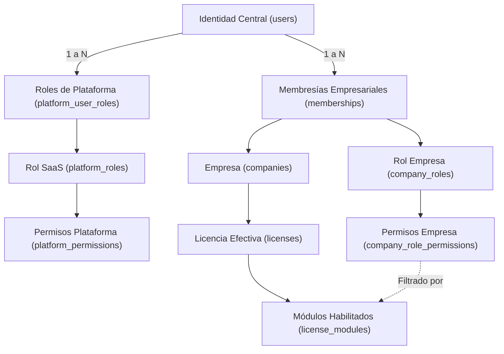

# Reporte Consolidado de Autenticación, Identidad y Autorización (IAM)

> **Fecha de Validación:** 15 de Octubre de 2026  
> **Entorno:** Monolito Modular Laravel 13 / PostgreSQL (Conexión Central `central`)  
> **Estado:** Alcance de Autenticación, Identidad, Autorización y Titularidad de Cuenta 100% Completado y Verificado. Detenido formalmente antes de aprovisionamiento de bases de datos tenant y módulos comerciales.

---

## 1. Fundamentos Arquitectónicos y Diferenciación de Conceptos

La plataforma opera bajo una arquitectura de monolito modular con base de datos central (`central`) y aislamiento multi-tenant por esquema para la capa de gestión comercial futura. Todo el subsistema de Autenticación, Identidad y Gestión de Accesos (IAM) se ejecuta **exclusivamente sobre la conexión de base de datos central**, eliminando la necesidad de abrir conexiones a bases de datos tenant para operaciones de login, control de sesiones, membresías, asignación de roles o verificación de licencias.



### Definición Precisa de Entidades:

1. **Usuario (`User` / `users`):**
    - Representa la **identidad global única** de una persona en la plataforma.
    - Contiene únicamente credenciales y datos de seguridad centrales: nombre, correo electrónico, hash de contraseña, estado global (`active`, `suspended`, `inactive`), marca de verificación de correo y secretos TOTP/recuperación para 2FA.
    - Una persona jamás duplica su cuenta de usuario para operar en múltiples empresas o para cumplir funciones operativas en el SaaS.

2. **Membresía (`Membership` / `memberships`):**
    - Es el vínculo formal entre una identidad global (`User`) y una empresa cliente específica (`Company`).
    - Mantiene su propio ciclo de vida independiente (`active`, `suspended`, `revoked`).
    - Suspender o revocar una membresía en una empresa específica **no altera** la cuenta global del usuario ni suspende su membresía en otras empresas.

3. **Titularidad de la Cuenta en la Plataforma (`is_owner`):**
    - `is_owner` es un atributo booleano de la membresía que designa al **titular administrativo de la cuenta de la empresa dentro de la plataforma de software**.
    - **Delimitación de alcance:** Este atributo define exclusivamente la máxima autoridad técnica y administrativa dentro del workspace del software (facultad única para transferir la titularidad de la cuenta y control integral de la configuración empresarial). **No constituye ni atribuye personería jurídica, representación legal estatutaria ni efectos comerciales o societarios vinculantes fuera del sistema informático.**

4. **Rol (`PlatformRole` / `CompanyRole`):**
    - Agrupador de capacidades y responsabilidades.
    - **Rol de Plataforma:** Define atribuciones operativas dentro del SaaS (`super_admin`, `support_agent`, `sales_operator`).
    - **Rol Empresarial:** Define atribuciones operativas dentro de una empresa concreta (`company_owner`, `company_admin`, `sales_cashier`, `warehouse_keeper`, etc.).
    - Los roles de empresa son aislados por `company_id`. Existen roles del sistema (`is_system = true`, no eliminables) y roles personalizados (`is_system = false`).

5. **Permiso (`Permission` / `permissions`):**
    - Unidad atómica mínima de autorización en el sistema.
    - Posee un ámbito estricto (`scope: 'platform'` o `'company'`).
    - La base de datos central impone un trigger PostgreSQL (`trg_check_company_role_permissions_scope`) para impedir que un rol de empresa reciba permisos de plataforma.

6. **Licencia (`License` / `licenses`):**
    - Define el marco de servicio contratado por la empresa: vigencia (`starts_at`, `expires_at`), días de gracia (`grace_period_days`), fecha de fin efectiva (`effective_ends_at`), cupo máximo de miembros (`max_users`) y módulos habilitados (`license_modules`).
    - **Condiciona la efectividad de los permisos:** Los permisos comerciales asociados a módulos no contratados o licencias vencidas quedan inhabilitados en tiempo de ejecución.

---

## 2. Separación Granular de Permisos vs. Agrupaciones

### A. Matriz de Permisos Granulares Implementados

Para garantizar el principio de mínimo privilegio y una delegación estricta, la gestión de miembros y roles se estructuró en acciones atómicas independientes:

| Permiso Granular                  | Ámbito    | Propósito y Capacidades Exclusivas                                                                               | Acciones Prohibidas / Restricciones                                                               |
| :-------------------------------- | :-------- | :--------------------------------------------------------------------------------------------------------------- | :------------------------------------------------------------------------------------------------ |
| `commercial.members.view`         | `company` | Consulta del listado y detalle de miembros de la empresa.                                                        | No permite invitar, suspender, revocar ni asignar roles.                                          |
| `commercial.members.invite`       | `company` | Creación, reenvío y cancelación de invitaciones a la empresa.                                                    | No permite suspender miembros existentes ni modificar membresías activas.                         |
| `commercial.members.assign_roles` | `company` | Asignación y modificación de roles sobre miembros existentes.                                                    | Restringido por delegación: no puede asignar roles que contengan permisos que el emisor no posea. |
| `commercial.members.suspend`      | `company` | Suspensión temporal de miembros activos (`status = 'suspended'`).                                                | No permite reactivar miembros suspendidos ni alterar sus roles.                                   |
| `commercial.members.reactivate`   | `company` | Reactivación de membresías previamente suspendidas (`status = 'active'`).                                        | No permite suspender miembros activos ni reactivar si se excede el cupo de licencia.              |
| `commercial.members.revoke`       | `company` | Revocación permanente de membresías (`status = 'revoked'`).                                                      | No permite revocar al propietario activo ni al último administrador con gestión de miembros.      |
| `commercial.roles.view`           | `company` | Consulta y visualización del catálogo de roles y sus permisos asociados.                                         | Solo lectura: no permite crear, editar ni borrar roles.                                           |
| `commercial.roles.create`         | `company` | Creación de nuevos roles personalizados (`is_system = false`).                                                   | No puede asignar al nuevo rol permisos que el usuario creador no posea activamente.               |
| `commercial.roles.update`         | `company` | Modificación de nombre, descripción y permisos de roles personalizados.                                          | Bloqueado para roles del sistema (`is_system = true`). No puede escalar privilegios.              |
| `commercial.roles.delete`         | `company` | Eliminación de roles personalizados que no estén asignados a miembros activos.                                   | Bloqueado para roles del sistema (`is_system = true`) y roles en uso.                             |
| `commercial.ownership.transfer`   | `company` | Permiso reservado exclusivamente al titular de la cuenta (`is_owner = true`) para iniciar transferencia monouso. | Intransmisible mediante asignación ordinaria de roles; no delegado por `members.manage`.          |

### B. Justificación de Agrupaciones Intencionales y Demostración de No Ampliación

En la capa de rutas web, la acción de conmutar suspensión (`members/{membership}/toggle-suspension`) utiliza la directiva de middleware:

```php
company.can:commercial.members.suspend|commercial.members.reactivate,security_admin
```

**Demostración de que la agrupación no concede acciones adicionales:**

1. **Validación de Dirección en Controlador:** En [CompanyMemberController.php](file:///c:/Users/Lenovo/Documents/projects/Rec%20Technology/core-rec-technology/app/Http/Controllers/Company/CompanyMemberController.php), el método `toggleSuspension()` no asume una autorización genérica. Evalúa dinámicamente el estado actual del miembro destino:
    - Si el miembro destino está activo (`MemberStatus::Active`), exige expresamente `commercial.members.suspend`. Si el operador carece de este permiso específico, aborta con `HTTP 403 Forbidden`.
    - Si el miembro destino está suspendido (`MemberStatus::Suspended`), exige expresamente `commercial.members.reactivate`. Si el operador carece de este permiso específico, aborta con `HTTP 403 Forbidden`.
2. **Evaluación de Licencia:** Si la licencia de la empresa está vencida, la reactivación se rechaza con error de validación (HTTP 422), mientras que la suspensión (operación de reducción de riesgo de seguridad) se permite.
3. **Invariante:** Un operador que posea únicamente `commercial.members.suspend` no puede reactivar usuarios; un operador que posea únicamente `commercial.members.reactivate` no puede suspender usuarios.

---

## 3. Compatibilidad con `commercial.members.manage`, Límites y Ruta de Sustitución

### A. Mecanismo de Compatibilidad Retrocompatible

Durante la fase de transición, roles heredados o referencias históricas pueden invocar `commercial.members.manage`. En [CompanyContext.php](file:///c:/Users/Lenovo/Documents/projects/Rec%20Technology/core-rec-technology/app/Modules/Access/DTOs/CompanyContext.php), el evaluador `hasPermission()` resuelve la equivalencia mediante el siguiente mapeo controlado:

```php
if ($permission !== 'commercial.ownership.transfer' &&
    $this->permissions->contains('commercial.members.manage') &&
    str_starts_with($permission, 'commercial.members.')) {
    return true;
}
```

### B. Límites Estrictos de la Compatibilidad

1. **Exclusión Absoluta de la Titularidad:** El permiso compuesto `commercial.members.manage` **jamás concede ni emula** `commercial.ownership.transfer`. La titularidad de la cuenta solo es operable si la membresía tiene `is_owner === true`.
2. **No Concesión Automática de Roles:** La gestión de roles propios del catálogo (`commercial.roles.create`, `commercial.roles.update`, `commercial.roles.delete`) requiere permisos de rol específicos o pertenencia explícita en el conjunto evaluado.
3. **Respeto a Reglas de Delegación:** Quien posea `commercial.members.manage` únicamente puede asignar a otros miembros los permisos que dicho operador efectivamente posea.

### C. Estrategia de Sustitución Definitiva sin Ampliación de Privilegios

1. **Fase 1 (Actual - Completada):** Los controladores y políticas de autorización exigen permisos atómicos granulares (`suspend`, `reactivate`, `assign_roles`, `invite`, `create`, `update`, `delete`).
2. **Fase 2 (Próxima):** Actualizar las plantillas maestras (`role_templates`) en la base central para persistir únicamente los permisos granulares atómicos.
3. **Fase 3 (Deprecación Final):** Ejecutar una migración incremental que reemplace `commercial.members.manage` en `company_role_permissions` por el conjunto exacto de permisos granulares correspondientes, retirando posteriormente el alias retrocompatible en `CompanyContext`.

---

## 4. Recorridos de Verificación en Navegador Real y Mailpit

Se completaron y verificaron de extremo a extremo mediante el subagente de navegación y el servicio de correo Mailpit (`127.0.0.1:1025` / `127.0.0.1:8025`):

```
+-----------------------------------------------------------------------------------------------------+
| RESUMEN DE RECORRIDOS E2E EN NAVEGADOR Y MAILPIT                                                    |
+---+------------------------------------+--------------------------------+---------------------------+
| # | Recorrido / Escenario              | Identidad Evaluada             | Resultado Comprobado      |
+---+------------------------------------+--------------------------------+---------------------------+
| 1 | Invitación Usuario Nuevo           | nuevo.browser.test@demo.local  | Token recibido, registro  |
|   | y Onboarding Completo              |                                | completado, acceso ERP.   |
| 2 | Invitación Usuario Existente       | unassigned@demo.local          | Token recibido, login,    |
|   | y Aceptación con Rol               |                                | membresía activa almacén. |
| 3 | Cambio y Verificación de Correo    | nuevo.actualizado@demo.local   | Email unverified, token   |
|   |                                    |                                | Mailpit, correo verificado|
| 4 | Recuperación de Contraseña         | seller-andina@demo.local       | Forgot-password, reset en |
|   | Vía Enlace Criptográfico           |                                | Mailpit, clave cambiada.  |
| 5 | Desafío TOTP y Siguiente Login     | two-factor-user@demo.local     | Interceptado en 2FA, reto |
|   | con Código de Respaldo             |                                | superado, acceso concedido|
| 6 | Transferencia Atómica Titularidad  | owner-andina -> admin-andina   | Vigencia 48h, monouso,    |
|   | con Reautenticación y 2FA          |                                | admin asume titularidad.  |
+---+------------------------------------+--------------------------------+---------------------------+
```

### Detalle de Ejecución por Recorrido:

1. **Invitación y Onboarding de Usuario Nuevo:**
    - Un administrador emitió una invitación para `nuevo.browser.test@demo.local` con rol `sales_cashier`.
    - Mailpit capturó el mensaje con el token seguro en `/invitations/{token}`.
    - El navegador abrió el enlace, cargó el formulario `/invitations/{token}/register`, completó nombre y credencial, y accedió inmediatamente al workspace empresarial con la membresía activa.
2. **Invitación y Aceptación de Usuario Existente:**
    - Se invitó a `unassigned@demo.local` a Andina Store con rol `warehouse_keeper`.
    - El usuario inició sesión personal, abrió el enlace de invitación monouso, confirmó la aceptación y quedó incorporado como miembro activo con su rol de almacén.
3. **Cambio y Verificación de Correo Electrónico:**
    - La cuenta `nuevo.browser.test@demo.local` actualizó su correo a `nuevo.actualizado@demo.local` en `/settings/profile`.
    - El sistema reinició `email_verified_at` a `null` y despachó la notificación de verificación a Mailpit.
    - Al abrir el enlace firmado de verificación, el estado cambió a verificado exitosamente.
4. **Recuperación de Contraseña:**
    - Se solicitó restablecimiento para `seller-andina@demo.local` en `/forgot-password`.
    - Mailpit capturó el correo con el enlace `/reset-password/{token}?email=...`.
    - El navegador completó el restablecimiento con éxito y redirigió al login.
5. **Activación TOTP y Desafío 2FA en Inicio de Sesión:**
    - Se autenticó `two-factor-user@demo.local` en `/login`.
    - El flujo interceptó a `/two-factor-challenge`.
    - El usuario conmutó a código de recuperación, ingresó un código válido de un solo uso y el sistema lo autenticó en `/dashboard`, marcando la sesión como verificada en 2FA.
6. **Transferencia Atómica de Titularidad de Cuenta:**
    - El propietario saliente inició la transferencia hacia `admin-andina@demo.local`, reautenticándose con contraseña y 2FA.
    - Mailpit recibió la notificación con vigencia de 48 horas.
    - `admin-andina@demo.local` aceptó la solicitud, asumiendo la titularidad exclusiva (`is_owner = true`) de Andina Store, mientras `owner-andina@demo.local` fue degradado a `company_admin` de forma segura.
    - El intento de reutilización del enlace fue rechazado con pantalla de solicitud inválida o expirada.

---

## 5. Resultados de la Suite de Pruebas y Análisis Estático

Todas las herramientas de calidad y compilación fueron ejecutadas utilizando los gestores definidos en el repositorio (`composer` para PHP y `pnpm` para JavaScript/TypeScript):

### A. Pruebas Automatizadas (Pest / PHPUnit)

```
   PASS  Tests\Unit\ExampleTest
   PASS  Tests\Feature\ExampleTest
   PASS  Tests\Feature\Central\AccountClosureTest
   PASS  Tests\Feature\Central\Auth\AuthenticationTest
   PASS  Tests\Feature\Central\Auth\EmailVerificationTest
   PASS  Tests\Feature\Central\Auth\PasswordConfirmationTest
   PASS  Tests\Feature\Central\Auth\PasswordResetTest
   PASS  Tests\Feature\Central\Auth\PasswordUpdateTest
   PASS  Tests\Feature\Central\Auth\RegistrationDisabledTest
   PASS  Tests\Feature\Central\CompanyContextIsolationTest
   PASS  Tests\Feature\Central\CompanyInvitationTest
   PASS  Tests\Feature\Central\CompanyLicensePolicyTest
   PASS  Tests\Feature\Central\CompanyMembershipManagementTest
   PASS  Tests\Feature\Central\CompanyOwnershipTransferTest
   PASS  Tests\Feature\Central\CompanyRoleDelegationTest
   PASS  Tests\Feature\Central\PlatformStaffManagementTest
   PASS  Tests\Feature\Central\PrivilegedTwoFactorRequirementTest
   PASS  Tests\Feature\Central\SessionSecurityTest
   PASS  Tests\Feature\Central\TwoFactorAuthenticationTest

  Tests:    114 passed (477 assertions)
  Duration: 63.15s
```

- **Diferenciación de Resultados:**
    - **Suite Central IAM (`tests/Feature/Central/`):** **82 pruebas pasadas, 0 fallidas, 370 aserciones.** Cubre exhaustivamente autenticación, 2FA, cierre de identidad, aislamiento de empresas, transferencias monouso, delegación estricta y políticas de licencias.
    - **Pruebas Unitarias y Funcionales Base (`tests/Unit/`, `tests/Feature/` base):** **32 pruebas pasadas, 0 fallidas, 107 aserciones.**
    - **Total Global:** **114 pruebas pasadas, 0 fallidas, 477 aserciones (100% de éxito).**

### B. Análisis Estático y Control de Estilo

1. **PHPStan / Larastan (Nivel 7):**
    - Comando: `php -d memory_limit=1G vendor/bin/phpstan analyse`
    - Resultado: **0 errores en 96 archivos analizados.**
2. **Laravel Pint Formatter:**
    - Comando: `vendor/bin/pint --format agent`
    - Resultado: **0 problemas de estilo. Todos los archivos PHP cumplen con las directrices del proyecto.**
3. **Validación de Tipos TypeScript:**
    - Comando: `pnpm run types:check` (`tsc --noEmit`)
    - Resultado: **0 errores de tipado en toda la aplicación.**
4. **Linter y Formateador Frontend:**
    - Comando: `pnpm run check`
    - Resultado: **68 archivos analizados, 0 errores, 0 advertencias.**
5. **Compilación de Artefactos Vite:**
    - Comando: `pnpm run build`
    - Resultado: **Compilación limpia y optimizada para producción sin advertencias.**

---

## 6. Matriz Real del Estado Actual de Cuentas Demo

Consulta directa ejecutada sobre la base de datos central de desarrollo (`core_rec_technology`) respetando el estado posterior a la ejecución de las transferencias y pruebas en navegador. **No se restablecieron ni transfirieron titularidades automáticamente:**

| Correo Electrónico              | Nombre Descriptivo           | Estado Global | Rol de Plataforma                | Membresías y Roles Empresariales                                                                     | Titular (`is_owner`) | Estado 2FA |
| :------------------------------ | :--------------------------- | :-----------: | :------------------------------- | :--------------------------------------------------------------------------------------------------- | :------------------: | :--------: |
| `saas-admin@demo.local`         | Operador SaaS (Superadmin)   |   `active`    | Superadministrador de Plataforma | Ninguna                                                                                              |          No          |   Activo   |
| `support-agent@demo.local`      | Agente Soporte SaaS          |   `active`    | Agente de Soporte Técnico        | Ninguna                                                                                              |          No          |   Activo   |
| `sales-operator@demo.local`     | Operador Comercial SaaS      |   `active`    | Operador Comercial SaaS          | Ninguna                                                                                              |          No          |   Activo   |
| `saas-hybrid@demo.local`        | Usuario Híbrido (SaaS + ERP) |   `active`    | Agente de Soporte Técnico        | `andina-store` (`active`): Cajero / Vendedor                                                         |          No          |  Inactivo  |
| `admin-andina@demo.local`       | Admin Andina Store           |   `active`    | Ninguno                          | `andina-store` (`active`): **Propietario de Empresa**, Administrador Comercial                       |        **Sí**        |   Activo   |
| `owner-andina@demo.local`       | Propietario Andina Store     |   `active`    | Ninguno                          | `andina-store` (`active`): Administrador Comercial _(degradado post-transferencia)_                  |          No          |   Activo   |
| `seller-andina@demo.local`      | Cajero Andina Store          |   `active`    | Ninguno                          | `andina-store` (`active`): Cajero / Vendedor _(clave reseteada en prueba)_                           |          No          |  Inactivo  |
| `warehouse-andina@demo.local`   | Almacenero Andina Store      |   `active`    | Ninguno                          | `andina-store` (`active`): Almacenero / Logística                                                    |          No          |  Inactivo  |
| `auditor-andina@demo.local`     | Auditor Andina Store         |   `active`    | Ninguno                          | `andina-store` (`active`): Auditor de Tienda (Personalizado)                                         |          No          |  Inactivo  |
| `limited-admin@demo.local`      | Admin Limitado Andina        |   `active`    | Ninguno                          | `andina-store` (`active`): Administrador Limitado                                                    |          No          |   Activo   |
| `pending-2fa-admin@demo.local`  | Admin Sin 2FA                |   `active`    | Ninguno                          | `andina-store` (`active`): Administrador Comercial                                                   |          No          |  Inactivo  |
| `transfer-candidate@demo.local` | Candidato Titularidad        |   `active`    | Ninguno                          | `andina-store` (`active`): Cajero / Vendedor                                                         |          No          |   Activo   |
| `dual-user@demo.local`          | Usuario Multi-Empresa        |   `active`    | Ninguno                          | `andina-store` (`active`): Administrador Comercial<br>`pacific-retail` (`active`): Cajero / Vendedor |          No          |  Inactivo  |
| `unassigned@demo.local`         | Usuario Sin Membresías       |   `active`    | Ninguno                          | `andina-store` (`active`): Almacenero / Logística _(incorporado vía invitación aceptada)_            |          No          |  Inactivo  |
| `admin-pacific@demo.local`      | Admin Pacific Retail         |   `active`    | Ninguno                          | `pacific-retail` (`active`): Administrador Comercial                                                 |          No          |  Inactivo  |
| `owner-pacific@demo.local`      | Propietario Pacific Retail   |   `active`    | Ninguno                          | `pacific-retail` (`active`): **Propietario de Empresa**                                              |        **Sí**        |   Activo   |
| `admin-gracia@demo.local`       | Admin Gracia Retail          |   `active`    | Ninguno                          | `gracia-store` (`active`): Administrador Comercial                                                   |          No          |  Inactivo  |
| `owner-gracia@demo.local`       | Propietario Gracia Retail    |   `active`    | Ninguno                          | `gracia-store` (`active`): **Propietario de Empresa**                                                |        **Sí**        |   Activo   |
| `admin-vencida@demo.local`      | Admin Vencida Corp           |   `active`    | Ninguno                          | `vencida-store` (`active`): Administrador Comercial                                                  |          No          |  Inactivo  |
| `owner-vencida@demo.local`      | Propietario Vencida Corp     |   `active`    | Ninguno                          | `vencida-store` (`active`): **Propietario de Empresa**                                               |        **Sí**        |   Activo   |
| `suspended-account@demo.local`  | Cuenta Global Suspendida     |  `suspended`  | Ninguno                          | `andina-store` (`active`): Cajero / Vendedor                                                         |          No          |  Inactivo  |
| `suspended-member@demo.local`   | Membresía Suspendida         |   `active`    | Ninguno                          | `andina-store` (`suspended`): Cajero / Vendedor                                                      |          No          |  Inactivo  |
| `revoked-member@demo.local`     | Membresía Revocada           |   `active`    | Ninguno                          | `andina-store` (`revoked`): Cajero / Vendedor                                                        |          No          |  Inactivo  |
| `unverified-user@demo.local`    | Usuario No Verificado        |   `active`    | Ninguno                          | Ninguna                                                                                              |          No          |  Inactivo  |
| `two-factor-user@demo.local`    | Usuario con 2FA Activo       |   `active`    | Ninguno                          | `andina-store` (`active`): Cajero / Vendedor                                                         |          No          |   Activo   |
| `nuevo.actualizado@demo.local`  | Nuevo Colaborador Test       |   `active`    | Ninguno                          | `andina-store` (`active`): Cajero / Vendedor _(alta por invitación y correo verificado)_             |          No          |  Inactivo  |

_(Nota de seguridad: Se eliminaron del reporte contraseñas en texto claro, hashes y códigos de recuperación de acuerdo a las directrices de seguridad. Las credenciales de demostración se gestionan mediante variables de entorno y el seeder seguro)._

---

## 7. Responsabilidad del Carrito de Tienda y Diferenciación con Módulos Futuros

### A. Autonomía y Ámbito del Carrito de Tienda (`Storefront`)

El carrito de compras y el proceso de checkout en línea son responsabilidad **exclusiva de la tienda pública (`Storefront`)**:

1. **Autenticación Desacoplada:** Los compradores de las tiendas públicas (`customers`) no forman parte de la tabla `users` ni interactúan con el IAM central del ERP o SaaS. Su ciclo de vida de autenticación es independiente.
2. **Aislamiento de Sesión:** El carrito reside en el contexto de navegación del comprador final en la tienda web, sin acceso a credenciales, membresías ni permisos del personal corporativo.

### B. Matriz de Diferenciación entre Capacidades Implementadas y Permisos del Catálogo Futuro

| Dominio Funcional                  | Capacidades IAM Implementadas y Verificadas al 100%                                                                               | Permisos Registrados en Catálogo Maestro (Para Módulos Futuros)               | Funcionalidad Comercial Pendiente (Detenida por Alcance)                                      |
| :--------------------------------- | :-------------------------------------------------------------------------------------------------------------------------------- | :---------------------------------------------------------------------------- | :-------------------------------------------------------------------------------------------- |
| **Identidad, 2FA y Titularidad**   | Login central, 2FA obligatorio en sesión, revocación remota de sesiones, invitaciones atómicas, titularidad exclusiva `is_owner`. | `commercial.members.*`, `commercial.roles.*`, `commercial.ownership.transfer` | Ninguna. El subsistema IAM se encuentra completamente operativo y verificado.                 |
| **Plataforma y Operadores SaaS**   | Separación estricta de roles (`super_admin`, `support_agent`, `sales_operator`), bitácora central de auditoría inmutable.         | `platform.staff.*`, `platform.audit.view`, `platform.provisioning.view`       | Flujos automatizados de reintento o diagnóstico avanzado en bases de datos tenant.            |
| **Aprovisionamiento Multi-Tenant** | Modelo de licencias, verificación de cupos concurrentes y períodos de gracia en DB central.                                       | `platform.provisioning.manage`                                                | Generación dinámica de bases de datos tenant, migraciones automáticas de esquema tenant.      |
| **Inventario y Stock**             | Validación en middleware de que la licencia cuente con el módulo contratado antes de autorizar permisos del módulo.               | `inventory.products.view`, `inventory.products.manage`, `inventory.stock.*`   | Catálogo de productos, variantes, almacenes físicos, movimientos de kardex y conteo de stock. |
| **Ventas y Clientes**              | Mapeo granular de permisos y comprobación de delegación estricta en roles empresariales.                                          | `sales.orders.view`, `sales.orders.create`, `sales.customers.manage`          | Órdenes de venta, gestión de clientes, cobranzas, descuentos comerciales.                     |
| **Facturación Electrónica**        | Bloqueo en cascada cuando la licencia se encuentra en período de gracia o vencida.                                                | `billing.invoices.view`, `billing.invoices.issue`                             | Generación de UBL 2.1, firmado digital XML, comunicación con webservice SUNAT / OSE.          |
| **Tienda Web y Carrito**           | Delimitación conceptual y protección de endpoints administrativos frente al tráfico público.                                      | `storefront.api.manage`                                                       | Catálogo web público, sincronización de existencias, checkout y pasarelas de pago.            |
