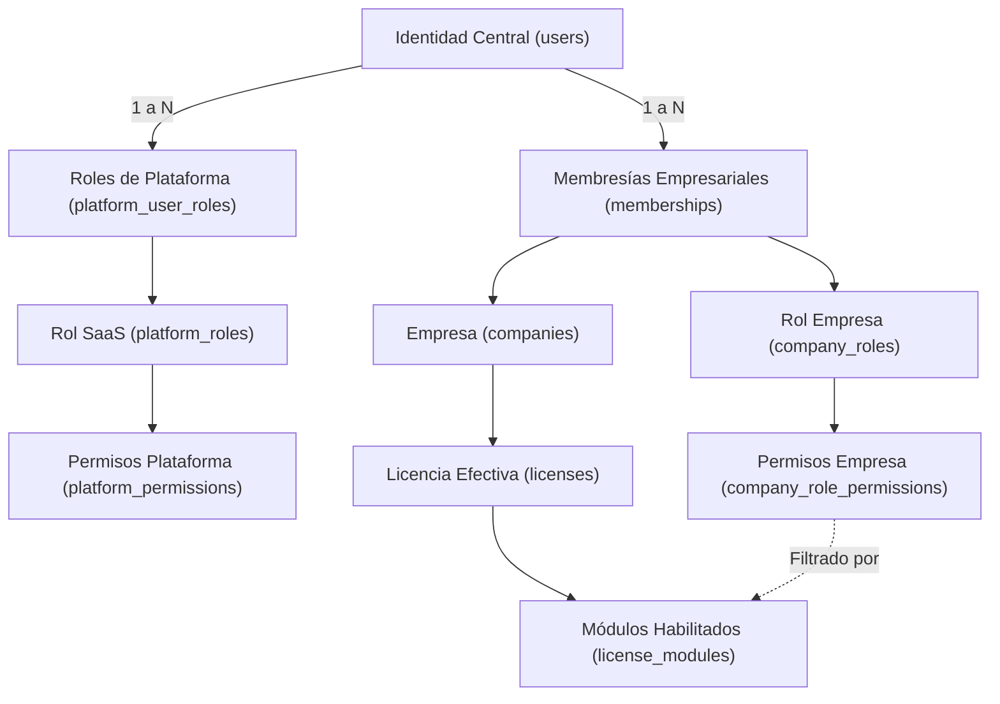

# Reporte Consolidado de Autenticación, Identidad y Autorización (IAM)

> **Fecha de Validación Original:** 15 de Octubre de 2026  
> **Actualización y Alineación:** 17 de Octubre de 2026  
> **Entorno:** Monolito Modular Laravel 13 (v13.35.0) / PostgreSQL 16 (Conexión Central `central`)  
> **Estado:** Alcance de Autenticación, Identidad, Autorización y Titularidad de Cuenta verificado en la base central. Fases subsiguientes de aprovisionamiento de bases comerciales (Fase 5), conexión por solicitud (Fase 6) y catálogo básico (Fase 7) implementadas posteriormente.

---

## 1. Fundamentos Arquitectónicos y Diferenciación de Conceptos

La plataforma opera bajo una arquitectura de monolito modular con base de datos central (`central`) y aislamiento multi-tenant mediante **bases de datos PostgreSQL independientes por cada empresa** (`rec_tenant_{company_id}`). Todo el subsistema de Autenticación, Identidad y Gestión de Accesos (IAM) se ejecuta **exclusivamente sobre la conexión de base de datos central**, sin interactuar con las bases de datos comerciales para operaciones de login, control de sesiones, membresías, asignación de roles o verificación de licencias.



### Definición Precisa de Entidades:

1. **Usuario (`User` / `users`):**
    - Representa la **identidad global única** de una persona en la plataforma.
    - Contiene credenciales y datos de seguridad centrales: nombre, correo electrónico, hash de contraseña, estado global (`active`, `suspended`, `inactive`), marca de verificación de correo y secretos TOTP/recuperación para 2FA.
    - Una persona no duplica su cuenta de usuario para operar en múltiples empresas o para cumplir funciones operativas en la administración central.

2. **Membresía (`Membership` / `memberships`):**
    - Vínculo formal entre una identidad global (`User`) y una empresa específica (`Company`).
    - Ciclo de vida independiente (`active`, `suspended`, `revoked`).
    - Suspender o revocar una membresía en una empresa específica **no altera** la cuenta global del usuario ni suspende su membresía en otras empresas.

3. **Titularidad de la Cuenta en la Plataforma (`is_owner`):**
    - Atributo booleano de la membresía que designa al **titular administrativo de la cuenta de la empresa dentro de la plataforma de software**.
    - **Delimitación de Alcance:** Este atributo define exclusivamente la máxima autoridad técnica y administrativa dentro del espacio empresarial del software (facultad única para transferir la titularidad de la cuenta y control integral de la configuración empresarial). **No constituye ni atribuye personería jurídica, representación legal estatutaria ni efectos societarios vinculantes fuera del sistema informático.**

4. **Rol (`PlatformRole` / `CompanyRole`):**
    - Agrupador de capacidades y responsabilidades.
    - **Rol de Plataforma:** Define atribuciones operativas dentro de la administración central (`super_admin`, `support_agent`, `sales_operator`).
    - **Rol Empresarial:** Define atribuciones operativas dentro de una empresa concreta (`company_owner`, `company_admin`, `sales_cashier`, `warehouse_keeper`, etc.).
    - Los roles de empresa están estrictamente aislados por `company_id`. Existen roles del sistema (`is_system = true`, no eliminables) y roles personalizados (`is_system = false`).

5. **Permiso (`Permission` / `permissions`):**
    - Unidad atómica mínima de autorización en el sistema.
    - Posee un ámbito estricto (`scope: 'platform'` o `'company'`).
    - La base central impone un trigger PostgreSQL (`trg_check_company_role_permissions_scope`) para impedir que un rol de empresa reciba permisos de plataforma.

6. **Licencia (`License` / `licenses`):**
    - Marco de servicio contratado por la empresa: vigencia (`starts_at`, `expires_at`), días de gracia (`grace_period_days`), fin efectivo (`effective_ends_at`), límite de miembros (`max_users`) y módulos habilitados (`license_modules`).
    - **Condiciona la efectividad de los permisos:** Permisos asociados a módulos no contratados quedan inhabilitados en tiempo de ejecución. Ante el vencimiento del plazo ordinario, el periodo de gracia permite únicamente lectura (`isReadOnly = true`), bloqueando mutaciones (HTTP 403).

---

## 2. Separación Granular de Permisos vs. Agrupaciones

### A. Matriz de Permisos Granulares Implementados

| Permiso Granular                  | Ámbito    | Propósito y Capacidades Exclusivas                                                                       | Acciones Prohibidas / Restricciones                                                               |
| :-------------------------------- | :-------- | :------------------------------------------------------------------------------------------------------- | :------------------------------------------------------------------------------------------------ |
| `commercial.members.view`         | `company` | Consulta del listado y detalle de miembros de la empresa.                                                | No permite invitar, suspender, revocar ni asignar roles.                                          |
| `commercial.members.invite`       | `company` | Creación, reenvío y cancelación de invitaciones a la empresa.                                            | No permite suspender miembros existentes ni modificar membresías activas.                         |
| `commercial.members.assign_roles` | `company` | Asignación y modificación de roles sobre miembros existentes.                                            | Restringido por delegación: no puede asignar roles que contengan permisos que el emisor no posea. |
| `commercial.members.suspend`      | `company` | Suspensión temporal de miembros activos (`status = 'suspended'`).                                        | No permite reactivar miembros suspendidos ni alterar sus roles.                                   |
| `commercial.members.reactivate`   | `company` | Reactivación de membresías previamente suspendidas (`status = 'active'`).                                | No permite suspender miembros activos ni reactivar si se excede el cupo de licencia.              |
| `commercial.members.revoke`       | `company` | Revocación permanente de membresías (`status = 'revoked'`).                                              | No permite revocar al propietario activo ni al último administrador con gestión de miembros.      |
| `commercial.roles.view`           | `company` | Consulta y visualización del catálogo de roles y sus permisos asociados.                                 | Solo lectura: no permite crear, editar ni borrar roles.                                           |
| `commercial.roles.create`         | `company` | Creación de nuevos roles personalizados (`is_system = false`).                                           | No puede asignar al nuevo rol permisos que el usuario creador no posea activamente.               |
| `commercial.roles.update`         | `company` | Modificación de nombre, descripción y permisos de roles personalizados.                                  | Bloqueado para roles del sistema (`is_system = true`). No puede escalar privilegios.              |
| `commercial.roles.delete`         | `company` | Eliminación de roles personalizados que no estén asignados a miembros activos.                           | Bloqueado para roles del sistema (`is_system = true`) y roles en uso.                             |
| `commercial.ownership.transfer`   | `company` | Reservado exclusivamente al titular de la cuenta (`is_owner = true`) para iniciar transferencia monouso. | Intransmisible mediante asignación ordinaria de roles; no delegado por `members.manage`.          |

### B. Evaluación Dinámica en Operaciones de Miembros

En [CompanyMemberController.php](file:///c:/Users/Lenovo/Documents/projects/Rec%20Technology/core-rec-technology/app/Http/Controllers/Company/CompanyMemberController.php), la acción de conmutar suspensión evalúa dinámicamente el estado actual del miembro destino:

- Si el miembro destino está activo (`MemberStatus::Active`), exige expresamente `commercial.members.suspend`. Si carece de este permiso específico, aborta con `HTTP 403 Forbidden`.
- Si el miembro destino está suspendido (`MemberStatus::Suspended`), exige expresamente `commercial.members.reactivate`. Si carece de este permiso específico, aborta con `HTTP 403 Forbidden`.
- Si la licencia de la empresa está vencida, la reactivación se rechaza con error de validación (HTTP 422), mientras que la suspensión (operación de reducción de riesgo) se permite.

---

## 3. Compatibilidad con `commercial.members.manage` y Sustitución

En [CompanyContext.php](file:///c:/Users/Lenovo/Documents/projects/Rec%20Technology/core-rec-technology/app/Modules/Access/DTOs/CompanyContext.php), el evaluador `hasPermission()` resuelve la equivalencia controlada:

```php
if ($permission !== 'commercial.ownership.transfer' &&
    $this->permissions->contains('commercial.members.manage') &&
    str_starts_with($permission, 'commercial.members.')) {
    return true;
}
```

**Límites:**

1. **Exclusión Absoluta de la Titularidad:** `commercial.members.manage` **nunca** concede `commercial.ownership.transfer`. La titularidad de la cuenta solo es operable si la membresía tiene `is_owner === true`.
2. **No Concesión Automática de Roles:** La gestión de roles propios (`roles.create`, `roles.update`, `roles.delete`) requiere permisos de rol específicos.
3. **Respeto a Reglas de Delegación:** Quien posea `members.manage` únicamente puede asignar a otros miembros los permisos que dicho operador efectivamente posea.
4. **Plantillas vs. Roles Existentes:** La actualización de plantillas maestras (`RoleTemplate`) aplica a empresas futuras; en empresas existentes, los roles materializados no se modifican automáticamente.

---

## 4. Recorridos de Verificación en Navegador Real y Mailpit

Los siguientes seis flujos fueron verificados de extremo a extremo mediante el subagente de navegación y el servicio de correo Mailpit:

```
+-----------------------------------------------------------------------------------------------------+
| RESUMEN DE RECORRIDOS E2E EN NAVEGADOR Y MAILPIT                                                    |
+---+------------------------------------+--------------------------------+---------------------------+
| # | Recorrido / Escenario              | Identidad Evaluada             | Resultado Comprobado      |
+---+------------------------------------+--------------------------------+---------------------------+
| 1 | Invitación Usuario Nuevo           | nuevo.browser.test@demo.local  | Token recibido, registro  |
|   | y Onboarding Completo              |                                | completado, acceso ERP.   |
| 2 | Invitación Usuario Existente       | unassigned@demo.local          | Token recibido, login,    |
|   | y Aceptación con Rol               |                                | membresía activa almacén. |
| 3 | Cambio y Verificación de Correo    | nuevo.actualizado@demo.local   | Email unverified, token   |
|   |                                    |                                | Mailpit, correo verificado|
| 4 | Recuperación de Contraseña         | seller-andina@demo.local       | Forgot-password, reset en |
|   | Vía Enlace Criptográfico           |                                | Mailpit, clave cambiada.  |
| 5 | Desafío TOTP y Siguiente Login     | two-factor-user@demo.local     | Interceptado en 2FA, reto |
|   | con Código de Respaldo             |                                | superado, acceso concedido|
| 6 | Transferencia Atómica Titularidad  | owner-andina -> admin-andina   | Vigencia 48h, monouso,    |
|   | con Reautenticación y 2FA          |                                | admin asume titularidad.  |
+---+------------------------------------+--------------------------------+---------------------------+
```

---

## 5. Resultados de Pruebas y Análisis Estático

### A. Pruebas Automatizadas Históricas (Validación IAM - 15/10/2026)

- **Suite Central IAM (`tests/Feature/Central/`):** 82 pruebas pasadas, 370 aserciones, 0 fallos.
- **Pruebas Unitarias y Funcionales Base (`tests/Unit/`, `tests/Feature/` base):** 32 pruebas pasadas, 107 aserciones, 0 fallos.
- **Total Reportado en Cierre IAM:** **114 pruebas pasadas, 477 aserciones, 0 fallos.**

### B. Pruebas Automatizadas Verificadas en Revisión Actual (17/10/2026)

- `vendor/bin/pest tests/Feature/Central/CentralSchemaIntegrityTest.php`: **3 pruebas pasadas, 3 aserciones, 0 fallos** (6.5s).
- `vendor/bin/pest tests/Feature/Central/PersonalAccountSecurityTest.php`: **5 pruebas pasadas, 41 aserciones, 0 fallos** (6.6s).
- `vendor/bin/pest tests/Feature/Tenant/ProductCatalogTest.php`: **18 pruebas pasadas, 107 aserciones, 0 fallos** (44.1s).

### C. Análisis Estático y Control de Estilo

1. **PHPStan / Larastan:**
    - Configuración: [phpstan.neon](file:///c:/Users/Lenovo/Documents/projects/Rec%20Technology/core-rec-technology/phpstan.neon) en **Nivel 7**.
    - Comando: `vendor/bin/phpstan analyse --memory-limit=1G`
    - Resultado: **0 errores.**
2. **Laravel Pint:**
    - Comando: `vendor/bin/pint --dirty --format agent`
    - Resultado: **Pasado con código 0.**
3. **TypeScript:**
    - Comando: `pnpm run types:check` (`tsc --noEmit`)
    - Resultado: **0 errores de tipado.**
4. **Linter Frontend:**
    - Comando: `pnpm run check` (`vp check`)
    - Resultado: **80 archivos analizados, 0 errores, 0 advertencias.**

---

## 6. Matriz de Cuentas Demo

Consulta sobre la base de datos central de desarrollo (`core_rec_technology`):

| Correo Electrónico              | Nombre Descriptivo            | Estado Global | Rol de Plataforma                | Membresías y Roles Empresariales                                                    | Titular (`is_owner`) | Estado 2FA |
| :------------------------------ | :---------------------------- | :-----------: | :------------------------------- | :---------------------------------------------------------------------------------- | :------------------: | :--------: |
| `saas-admin@demo.local`         | Operador Central (Superadmin) |   `active`    | Superadministrador de Plataforma | Ninguna                                                                             |          No          |   Activo   |
| `support-agent@demo.local`      | Agente Soporte Central        |   `active`    | Agente de Soporte Técnico        | Ninguna                                                                             |          No          |   Activo   |
| `sales-operator@demo.local`     | Operador Comercial Central    |   `active`    | Operador Comercial               | Ninguna                                                                             |          No          |   Activo   |
| `saas-hybrid@demo.local`        | Usuario Híbrido               |   `active`    | Agente de Soporte Técnico        | `andina-store` (`active`): Cajero / Vendedor                                        |          No          |  Inactivo  |
| `admin-andina@demo.local`       | Admin Andina Store            |   `active`    | Ninguno                          | `andina-store` (`active`): **Propietario de Empresa**, Administrador Comercial      |        **Sí**        |   Activo   |
| `owner-andina@demo.local`       | Propietario Original Andina   |   `active`    | Ninguno                          | `andina-store` (`active`): Administrador Comercial _(degradado post-transferencia)_ |          No          |   Activo   |
| `seller-andina@demo.local`      | Cajero Andina Store           |   `active`    | Ninguno                          | `andina-store` (`active`): Cajero / Vendedor                                        |          No          |  Inactivo  |
| `warehouse-andina@demo.local`   | Almacenero Andina Store       |   `active`    | Ninguno                          | `andina-store` (`active`): Almacenero / Logística                                   |          No          |  Inactivo  |
| `auditor-andina@demo.local`     | Auditor Andina Store          |   `active`    | Ninguno                          | `andina-store` (`active`): Auditor de Tienda (Personalizado)                        |          No          |  Inactivo  |
| `limited-admin@demo.local`      | Admin Limitado Andina         |   `active`    | Ninguno                          | `andina-store` (`active`): Administrador Limitado                                   |          No          |   Activo   |
| `pending-2fa-admin@demo.local`  | Admin Sin 2FA                 |   `active`    | Ninguno                          | `andina-store` (`active`): Administrador Comercial                                  |          No          |  Inactivo  |
| `transfer-candidate@demo.local` | Candidato Titularidad         |   `active`    | Ninguno                          | `andina-store` (`active`): Cajero / Vendedor                                        |          No          |   Activo   |
| `dual-user@demo.local`          | Usuario Multi-Empresa         |   `active`    | Ninguno                          | `andina-store` (`active`): Admin Comercial<br>`pacific-retail` (`active`): Cajero   |          No          |  Inactivo  |
| `unassigned@demo.local`         | Usuario Sin Membresías        |   `active`    | Ninguno                          | `andina-store` (`active`): Almacenero _(incorporado por invitación)_                |          No          |  Inactivo  |
| `admin-pacific@demo.local`      | Admin Pacific Retail          |   `active`    | Ninguno                          | `pacific-retail` (`active`): Administrador Comercial                                |          No          |  Inactivo  |
| `owner-pacific@demo.local`      | Propietario Pacific Retail    |   `active`    | Ninguno                          | `pacific-retail` (`active`): **Propietario de Empresa**                             |        **Sí**        |   Activo   |

_(Nota de seguridad: Los códigos de recuperación 2FA son monouso; al ser utilizados en pruebas de navegador quedan consumidos e invalidados)._

---

## 7. Diferenciación con Módulos Posteriores

| Dominio Funcional                | Capacidades IAM Implementadas en Base Central                                                                                                             | Permisos Registrados en Catálogo Maestro                                      | Estado Comercial Real                                                                                                                                                    |
| :------------------------------- | :-------------------------------------------------------------------------------------------------------------------------------------------------------- | :---------------------------------------------------------------------------- | :----------------------------------------------------------------------------------------------------------------------------------------------------------------------- |
| **Identidad, 2FA y Titularidad** | Login central, 2FA obligatorio en sesión, revocación remota de sesiones, invitaciones atómicas, titularidad exclusiva `is_owner`.                         | `commercial.members.*`, `commercial.roles.*`, `commercial.ownership.transfer` | Operativo y verificado en base central.                                                                                                                                  |
| **Administración Central**       | Separación estricta de roles (`super_admin`, `support_agent`, `sales_operator`), bitácora central de auditoría inmutable.                                 | `platform.staff.*`, `platform.audit.view`, `platform.provisioning.view`       | Operativo y verificado en base central.                                                                                                                                  |
| **Aprovisionamiento Comercial**  | Creación automatizada de bases comerciales (`rec_tenant_{id}`), credenciales DDL/DML segregadas, inyección de `tenant_identity`, DAC y locks consultivos. | `platform.provisioning.manage`                                                | **Implementado (Fase 5)** mediante `TenantProvisioningService`.                                                                                                          |
| **Conexión Dinámica**            | Resolución de contexto en `/app/{company:slug}`, validación de `tenant_identity`, conexión DML no privilegiada y protección con `TenantBuilder`.          | `commercial.company.view`                                                     | **Implementado (Fase 6)** mediante `TenantConnectionManager`.                                                                                                            |
| **Catálogo de Productos**        | Permisos explícitos separados (`products.view`, `products.manage`, `categories.manage`, `units.manage`).                                                  | `inventory.products.*`, `inventory.categories.*`, `inventory.units.*`         | **Implementado (Fase 7):** Productos simples, categorías y unidades de medida. **Pendiente:** Variantes, listas de precios, imágenes, existencias en almacenes y kardex. |
| **Ventas y Clientes**            | Taxonomía de permisos registrada en base central.                                                                                                         | `sales.orders.view`, `sales.orders.create`, `sales.customers.manage`          | **Pendiente:** Modelos, tablas y lógica de ventas no desarrollados.                                                                                                      |
| **Facturación Electrónica**      | Taxonomía de permisos registrada en base central.                                                                                                         | `billing.invoices.view`, `billing.invoices.issue`                             | **Pendiente:** Generación UBL, firma XML y comunicación tributaria no desarrollados.                                                                                     |
| **Tienda Web y Checkout**        | Autenticación de compradores desacoplada de `users`.                                                                                                      | `storefront.api.manage`                                                       | **Pendiente:** E-commerce público y pasarelas de pago no desarrollados.                                                                                                  |
